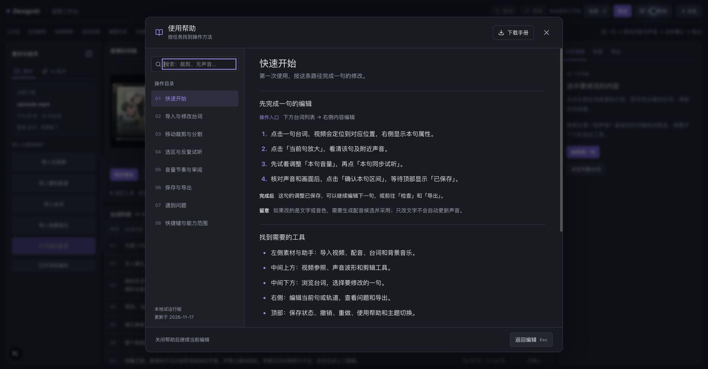

# 音频工作台手册优化与平台接入记录

记录日期：2026-11-17。范围：当前本地隔离 demo 的使用手册与工作台帮助入口。

## 为什么修改

工作台面向已有视频、台词与配音的最后一公里编辑。用户需要快速理解从选择台词、局部精修、试听确认到保存交付的路径，并在操作过程中随时查找具体方法。

原手册已覆盖功能，本次重点改善阅读结构，并将手册直接放进工作台。

## 本次完成

| 改动 | 用户现在可以做什么 |
| --- | --- |
| 手册重组为 8 个主题 | 从快速开始进入，按需查找台词、剪辑、选区、混音、导出与问题处理 |
| 统一操作说明 | 每项按入口、编号步骤、完成结果和注意事项阅读 |
| 首次操作路径 | 先完成一句的选择、音量调整、同步试听、区间确认与保存 |
| 工作台顶部「使用帮助」 | 不离开当前工程即可查阅手册 |
| 目录与关键词搜索 | 搜索标题、步骤和常用词；标题匹配优先，无结果时可清空搜索 |
| 阅读导航 | 切换主题或上一节、下一节；正文独立滚动 |
| 深浅主题 | 帮助窗口跟随工作台主题，窄屏下目录改为横向排列 |
| 关闭并继续编辑 | 支持关闭按钮、返回编辑和 Esc，关闭后恢复入口焦点 |
| Word 下载与 Markdown 文档 | 平台内下载离线手册，仓库内也可直接阅读 |

八个主题依次为：快速开始、导入与修改台词、移动裁剪与分割、选区与反复试听、音量节奏与审阅、保存与导出、遇到问题、快捷键与能力范围。

## 与前序工作台改动的关系

本次手册描述的是前序已实现的音频编辑工作台：真实波形、直接移动与拖边裁剪、播放头分割、复制粘贴删除、撤销重做、范围试听、轨道属性，以及三种布局预设、面板尺寸记忆和深浅模式。

这些能力的前序验证记录见 [功能对照表](../../feature-parity.md#音频工作台专业交互本地隔离验收)。本次新增的是说明与入口，不将前序编辑功能重复计为本次新功能。

## 主要文件

| 文件 | 用途 |
| --- | --- |
| [manual-content.json](../../../apps/web/app/session-apps/manual-content.json) | 手册主题、步骤和关键词的结构化内容 |
| [manual.ts](../../../apps/web/app/session-apps/manual.ts) | 内容类型、关键词规范化与匹配排序 |
| [manual-dialog.tsx](../../../apps/web/app/session-apps/manual-dialog.tsx) | 帮助窗口、搜索、目录、导航与下载 |
| [manual.module.css](../../../apps/web/app/session-apps/manual.module.css) | 阅读排版、主题与窄屏布局 |
| [client.tsx](../../../apps/web/app/session-apps/client.tsx) | 顶部入口与帮助窗口挂载 |
| [使用手册 Markdown](../../audio-workbench-user-guide.zh-CN.md) | 仓库阅读版 |
| [使用手册 Word](../../../apps/web/public/help/audio-workbench-manual.docx) | 平台静态下载件，8 页 |

README 已加入帮助入口与文档链接；`docs/feature-parity.md` 已补充本次验收结果。

维护时先更新 `manual-content.json`，再同步 Markdown 与 Word 下载件，并检查平台文案、下载内容及按钮名称一致。本次未建立自动生成流水线。

## 已执行验证

以下是实现本次改动时的结果；此次归档仅整理记录，没有重新执行这些功能测试。

- Web 类型检查、`pnpm guard` 与独立输出目录的 Web 生产构建通过。
- Chrome 验证目录阅读、搜索「裁剪」的排序、无结果提示及清空搜索。
- 验证 Esc 关闭、入口焦点恢复，以及关闭帮助后所选台词与播放位置保持。
- 检查深浅主题、窗口居中和步骤编号。
- 点击「下载手册」下载成功，下载文件与仓库 Word 文件字节一致。
- Word 渲染为 8 页，逐页检查文字、分页和排版。
- 改动通过 `git diff --check`。

## 边界与后续注意

- 本次帮助为前端只读内容和静态文件，不新增工程数据写入、后端接口、权限或部署合同。
- 验证环境是用户已授权的本地隔离 demo；不代表 Appwrite、正式宿主或 staging 已验收。
- 本次没有重新执行 AI 生成、完整成片导出或全量编辑回归；前序测试结果不能当作本次复测。
- 窄屏适配已实现，本次记录的实际视觉检查为桌面深浅主题。
- 手册明确说明：改文字后需生成并采用配音；分割文字需人工核对；A/B 仅保存时间区间；渐变不等于交叉淡化；交接包不是剪映或达芬奇原生工程。
- 词级自动对齐、保持音高的时长适配、交叉淡化、任意多轨重叠、自动降噪、响度统一、完整候选版本库及后台导出仍属未提供能力。

本记录不代表发布或 Git 提交完成；此次记录操作未提交、推送或部署。
