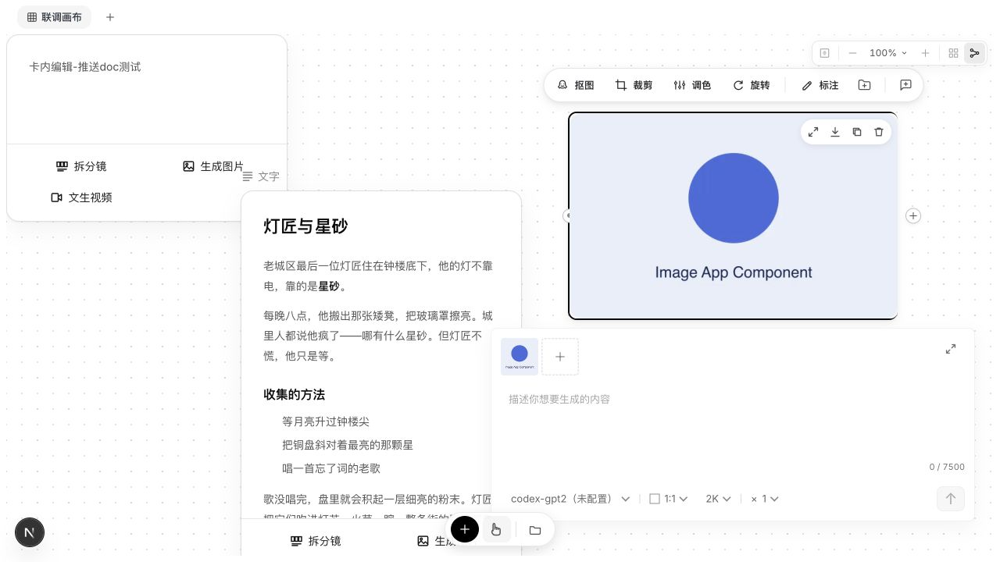
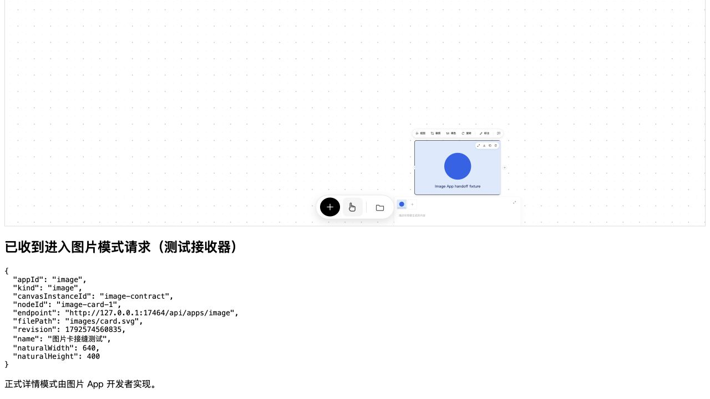

# 图片卡与图片 App 打开合同验收

> 历史验收快照：以下为记录日期的结果和现场路径，不作为当前配置；不应重建已退役的数据目录。原始日志/会话不随源码交付，当前版本以发布清单为准。

2026-10-21，本地隔离验收；没有调用 MA、图片 Provider、图片 Appwrite 后端或正式详情模式。

## 完整画布追加验收

同日已完成实际完整服务接入：`http://127.0.0.1:17580/?projectId=canvas-d378a657-e85`（原有联调画布，数据根 `/Users/zhuzhiheng/Desktop/canvas-data`，Canvas API `17462`）。独立图片仓库的 `@ks-designai/image-card-pack@0.1.1` 提供 `/react` 内嵌组件和 `/server` 纯登记元数据。画布从 vendor tarball 安装，不引用独立仓源码。

浏览器确认 `data-image-app-component=canvas-card` 实际渲染 1 个独立包组件；图片与文档卡同屏。新增“图片组件接入示例”通过实际上传 PNG 和 `image.attach` 保存，刷新后仍在；裁剪面板可打开并取消；未实现的详情模式返回明确提示。没有为完整服务伪造图片 App 后端登记。

组件当前负责图片展示框与模式入口，预览、状态和原有工具通过插槽注入；裁剪/调色等已有工具尚未整体抽取到图片仓库。图片仓库类型检查、2 项测试、构建通过；安装 tarball 的 React 消费者 SSR 通过；完整 Web、画布类型检查通过；服务端 345 通过、1 跳过，画布 240 通过。surface 重新构建与打包通过，未发布 npm。



## 结果

- 独立 `designai-app-image` 包：类型检查、1 项测试、构建及 tarball 打包通过。
- Canvas 服务端：345 通过、1 跳过；画布：240 通过。两包类型检查通过。
- 浏览器运行实际安装的 `@ks-designai/canvas-surface@0.1.3` tarball，React 18.3.1，真实图片来自隔离 Canvas HTTP 服务。
- 选中图片可见原有操作和“进入图片模式”。未接回调明确提示未接入；动态连接回调后，未登记返回“图片 App 尚未注册”。
- 仅在隔离测试服务中登记元数据后，点击按钮可在测试接收器读到 `image-contract / image-card-1 / images/card.svg`、640×400 与实际画布 revision。没有创建图片 App 业务实例或详情 UI。
- 动态连接回调的浏览器验收发现 Flow 保留旧回调，已通过读取当前宿主引用修复，并用重新安装的产物复验通过。
- 保存冲突、错误节点返回、切换画布和权限失败均有拒绝打开的测试。服务端测试核对打开前后快照相同。



## 复现

使用 Node 24、pnpm 10.33.2，从画布仓库执行：

```sh
pnpm --filter @ks-designai/canvas-surface build
pnpm --filter @ks-designai/canvas-surface pack:surface
pnpm exec tsx e2e/ui/image-app-handoff-fixture.ts --data-dir /tmp/image-handoff-new-root --port 17464
```

数据目录必须不存在，fixture 拒绝覆盖已有数据。其管理授权回调只供 loopback 隔离测试，不用于生产。

另建临时消费者目录，把本目录 `consumer/` 中三个文件复制进去，创建包含 `type=module` 的 package.json，用 npm 安装本地 canvas-surface tarball、`react@18.3.1`、`react-dom@18.3.1`、`@xyflow/react@12.8.5`、`vite@8.3.4`。执行 `npx vite --config vite.config.ts --force`，访问 `http://127.0.0.1:18583/`。更换同版本 tarball 时须重新安装并强制清理 Vite 依赖缓存。

依次选中图片 → 进入图片模式（未接入）→ 连接测试接收器 → 进入图片模式（未登记）→ 登记测试图片 App → 进入图片模式（读到当前图片描述）。测试登记只发生在新建的隔离数据目录。

## 限制

全仓 guard 仍被已有 MF React 版本配对和两个未登记 `.mjs` 构建文件阻塞，见 `guard.txt`。全仓 typecheck 还被 E2E 中既有 fixture 引用缺失与 Appwrite BlobPart 类型问题阻塞，见 `root-typecheck.txt`。包级验证通过不能等同全仓全绿。图片包和 surface 0.1.3 均只在本地打包，未发布，现有 MA 页面未升级。本轮没有测真实图片 App 详情或 Appwrite 业务。
