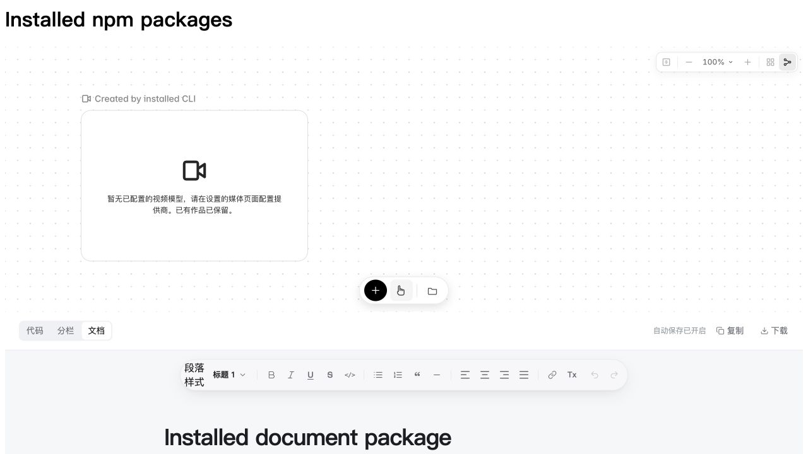

# npm 交付与联调验收（2026-10-21）

## 安装

公司内网 registry：`https://npm.corp.kuaishou.com/`。已创建 `@ks-designai` scope 并发布以下包；使用固定版本，不依赖标签自动升级。

```sh
# 宿主前端（React/ReactDOM 18.3.1；Canvas 还要求 @xyflow/react 12.8.5）
npm install @ks-designai/canvas-surface@0.1.2 @ks-designai/doc-surface@0.1.2 react@18.3.1 react-dom@18.3.1 @xyflow/react@12.8.5 --registry=https://npm.corp.kuaishou.com/

# MA 的命令执行环境，Node 24
npm install -g @ks-designai/canvas-cli@0.1.1 --registry=https://npm.corp.kuaishou.com/
canvas-cli --version
canvas-cli --help
```

宿主 import 使用新包名及各自 `/styles.css`。若现有包装层仍使用旧 import 名，可以使用 npm alias 替代本机 file 依赖，无需更改公共 SDK：

```json
{
  "dependencies": {
    "@canvas-workspace/canvas-surface": "npm:@ks-designai/canvas-surface@0.1.2",
    "@doc/surface": "npm:@ks-designai/doc-surface@0.1.2"
  }
}
```

画布组件需要 `projectId`、`uiHost`、`transport`；文档组件需要实际 `DocMeta` 和 `DocDocumentApi`。参考各包 README 与现有 MA 插件包装层，保留其 moduleId/exportName/version 匹配。npm 包安装不替代应用目录登记，也不会自动向 MA 注册工具。

CLI 配置 `CANVAS_SERVER_URL`、受保护的 `CANVAS_AUTH_TOKEN` 以及租户、用户上下文。地址必须能从 MA 执行环境访问；不要配置用户电脑的 loopback 地址作为远端地址。后端自行校验身份和权限，不信任 CLI 自报身份。MA Provider 实例 ID 需先映射到实际 canvas/doc ID，不能混用。

CLI 包内 `skills/canvas-cli/SKILL.md` 可交给 MA 已支持的 Skill 加载器。调用过程为能力发现 → 状态/绑定读取 → 按 schema 提交 → 回执和状态读回。Canvas operations 使用 `baseRevision`，文档正文按其合同使用内容版本及基线，不混传版本字段。

## 已验证

- 画布/文档包和 CLI 均独立打包，不含 workspace/file 运行依赖和本机源码软链。
- 独立目录先安装 tgz，再在另一个独立目录仅通过内网包名安装；从 lockfile 确认解析到公司 registry。
- 安装后的 CLI 能发现画布和已注册文档；实际创建、读取、修改并读回专用测试实例。
- 画布同 operationId 重放返回同一回执，状态不重复；旧 revision 写入返回 `CANVAS_REVISION_CONFLICT`；缺失实例退出非零。
- 两个安装后的 UI 包在同一独立宿主构建并真实渲染；画布中显示已安装 CLI 创建的卡片。文档 UI 渲染测试使用只读 fixture，真实文档读写另由 CLI 经真实网关验收，二者不混称。
- 画布独立消费验证通过：严格声明检查 `skipLibCheck=false`、单份 React、Vite 构建、SSR 公共 API、未挂载 flush 拒绝。
- 画布包测试 3 项通过；文档服务测试 65 项通过；CLI、工具、文档组件与文档壳类型检查通过，文档壳构建通过。
- 上传后核对 registry integrity 与本地产物一致，见 [发布记录](published.json)；包名安装与实际联调见 [registry-install.json](registry-install.json)。

## 验收边界

交付 MVP：包分发、独立安装、真实本地服务发现和读写已验。不是正式云端业务验收：尚未进入一涵远端 MA 容器安装/加载 Skill，未证明模型自主选择工具，未完成正式应用登记或 staging 服务认证/部署。

当前 MA-V `18581` 仍是此前明确标注的本地模拟登记；未修改其宿主/SDK。其现有 Kit 包装层也没有被本次自动替换。交接方按上方包名或 alias 安装，再通过现有 registry 入口挂载。

全仓仍未全绿：guard 报 MF React/ReactDOM 配对及两个既有 `.mjs` 产物未登记；根 typecheck 报 e2e 缺失 `extension-fixture`、`browser-fixture`。这些不属于本次分发改动，未绕过或改成假通过。

发布包由工作区构建；npm 发布时尚未提交 Git，后续代码提交与推送单独核验，本记录不代表生产服务部署。首次版本还包含 CLI 0.1.0，最终固定使用 0.1.1。

复验：在本仓运行 `CANVAS_SERVER_URL=<专用测试服务> DOC_SERVER_URL=<专用文档服务> DISTRIBUTION_VERIFICATION_MODE=registry pnpm exec tsx scripts/verify-app-distribution.ts <独立安装目录绝对路径>`。该脚本新建专用实例并保留证据，不改用户正文。


